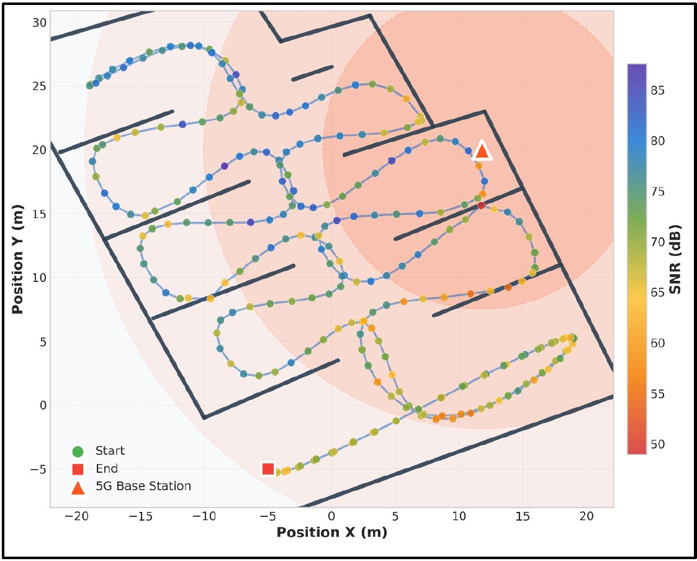
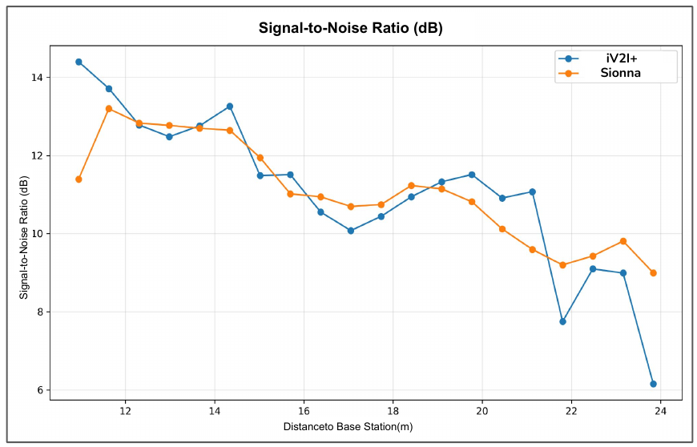
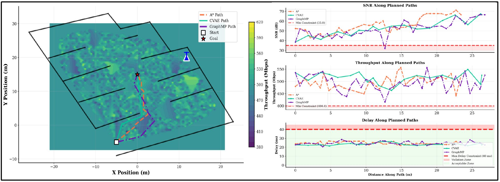

<div align="center">

# Network-Aware Path Planning for Autonomous Mobile Robots in Industrial Environments

**Om Kathalkar¹ · Houssam Hajj Hassan² · Ajay Kattepur¹ · Georgios Bouloukakis³**

¹Ericsson Research, India  ²Télécom SudParis, Institut Polytechnique de Paris, France  ³University of Patras, Greece

*IEEE ANTS*

[](#acknowledgements)
[](https://nvlabs.github.io/sionna/)
[](LICENSE)

</div>

<p align="center">
  
  <br><em>An AMR trajectory in the simulated industrial environment, coloured by SNR from Sionna ray tracing</em>
</p>

---

## Overview

Classical path planners like A* and RRT optimise only for geometry. In a factory, the shortest path can lead an Autonomous Mobile Robot (AMR) through wireless dead zones caused by metal structures and machinery. When that happens, it can lose coordination, control and safety links.

This work adds **wireless network quality (SNR, throughput and delay) to path planning as constraints**:

1. **Validated radio simulation.** NVIDIA Sionna ray tracing is checked against real industrial measurements from the iV2I+ dataset (Hernangómez et al.).
2. **Network quality maps.** The validated simulator produces SNR, throughput and delay at 0.5 m resolution.
3. **Three network-aware planners.** These are network-constrained A\*, a Conditional VAE (CVAE) and a graph-neural-network planner (GraphMP). They are compared under the same constraints.
4. **Deployment guidelines.** These give advice on which planner to use for which kind of industrial application.

## Sionna Validation

The simulation reproduces the iV2I+ setup:
- a 40 × 35 m industrial space with concrete floors, metal walls and machinery
- a base station at (11.8, 20)
- 3.75 GHz carrier, 23 dBm transmit power, 100 MHz bandwidth
- 4×4 MIMO with 3GPP TR 38.901 antenna patterns

To save computation, rays are traced at sparse grid points and the values in between are interpolated. This cuts computation time by **85%**.

| Metric | R² | RMSE |
|---|---|---|
| SNR | **0.87** | 2.3 dB |
| Throughput | **0.82** | 4.1 Mbps |
| Latency | **0.79** | 3.8 ms |

<p align="center">
  
  <br><em>SNR against distance to the base station: Sionna simulation vs. real iV2I+ measurements</em>
</p>

## Problem Formulation

The environment is a graph $G = (V, E)$. Each node $v$ carries network metrics $M(v) = \{\text{SNR}, \text{TP}, \text{Delay}\}$ from the validated simulation. The planner looks for the path $P$ from start $s$ to goal $g$ that minimises:

$$\min_P \left[ \sum_{i=1}^{n-1} d(v_i, v_{i+1}) + \lambda \sum_{i=1}^{n} \sum_{j=1}^{k} \max\big(0, \phi_j(m_j(v_i), c_j)\big) \right]$$

Here $d$ is spatial distance, $c_j$ are application-specific thresholds, and $\phi_j$ are smooth penalties for violating them.

| Metric | Thresholds |
|---|---|
| SNR | 15 dB (basic connectivity) to 25 dB (reliable operation) |
| Throughput | 1–10 Mbps (telemetry), 10–50 Mbps (video), 50+ Mbps (real-time sensing) |
| Delay | < 100 ms (non-critical), < 50 ms (control loops), < 10 ms (safety-critical) |

## Planners

**Network-constrained A\*.** A\* with network penalties added to its cost:

$$f(n) = g(n) + h(n) + \sum_{i \in \{\text{SNR}, \text{TP}, \text{Delay}\}} w_i\, \phi_i(n)$$

Each penalty is quadratic, for example $\phi_{\text{SNR}}(n) = \max\big(0, \tfrac{\text{SNR}_{\min} - \text{SNR}(n)}{\text{SNR}_{\min}}\big)^2$. Network quality comes from precomputed lookup tables, so the planner stays optimal and runs in $O(V \log V)$.

**CVAE.** Learns $p(\text{path} \mid \text{start}, \text{goal}, \text{constraints})$ from 15,000 example paths.
- A convolutional encoder reads the Sionna quality maps.
- An LSTM decoder with attention generates the path.
- The loss is $\mathcal{L}_{\text{recon}} + \beta\mathcal{L}_{KL} + \alpha\sum\mathcal{L}_{\text{constraint}} + \gamma\mathcal{L}_{\text{smooth}}$, with $\beta = 0.1$, $\alpha = 2.0$, $\gamma = 0.5$, trained for 200 epochs.

**GraphMP.** A graph neural network that guides A\* search.
- Each node has the features $[x, y, \text{SNR}, \text{TP}, \text{Delay}, \nabla\text{SNR}, \nabla\text{TP}, \text{safety}]$.
- A GAT network predicts how feasible each edge is.
- A GCN network estimates the heuristic.

<p align="center">
  
  <br><em>Paths from the three planners over the throughput map (left), and SNR, throughput and delay along each path (right)</em>
</p>

## Results

| Algorithm | Planning time (ms) | Path length (m) | Efficiency | Avg SNR (dB) | Avg TP (Mbps) | Avg delay (ms) | TP violations | Delay violations |
|---|---|---|---|---|---|---|---|---|
| A\* | **61.81** | 24.23 | 0.851 | **55.92** | **504.27** | **24.20** | 0 | 41 |
| CVAE | 84.11 | **23.61** | **0.873** | 55.62 | 498.27 | 24.88 | 0 | **15** |
| GraphMP | 2287.48 | 26.68 | 0.773 | 52.66 | 498.05 | 24.30 | 0 | 41 |

- **CVAE** gives the best overall balance. It has the highest efficiency, the shortest paths and 73% fewer delay violations than the other two.
- **A\*** is deterministic and optimal, with zero throughput violations, so it is the safe choice for safety-critical tasks.
- **GraphMP** is about 37× slower than A\*. It only pays off when plans are repeated many times in a stable environment.

## Which Planner to Use

| Scenario | Recommended |
|---|---|
| Safety-critical work (hazardous materials, emergency response) | **A\***: optimal, interpretable and auditable |
| Time-sensitive logistics and changing warehouse layouts | **CVAE**: efficient, with few delay violations |
| Repeated planning in a fixed layout | **GraphMP**: setup cost is spread over many plans |
| General deployment | **Hybrid**: a fast first path from CVAE, then refined with A\* for critical missions |

## Code

🚧 **Code is coming soon.** Watch or star this repository to get notified.

## Future Work

- Dynamic environments with moving obstacles
- Coordinating multiple robots under network constraints
- Online learning to adapt to changing conditions

## Citation

```bibtex
@inproceedings{kathalkar2025networkaware,
  author    = {Kathalkar, Om and Hajj Hassan, Houssam and Kattepur, Ajay and Bouloukakis, Georgios},
  title     = {Network-Aware Path Planning for Autonomous Mobile Robots in Industrial Environments},
  booktitle = {IEEE International Conference on Advanced Networks and Telecommunications Systems (ANTS)},
  year      = {2025}
}
```

## Acknowledgements

This work is supported by the Horizon Europe project **PANDORA** under grant agreement No. 101135775. The validation uses the iV2I+ industrial dataset by Hernangómez et al.

## Contact

For questions, open an [issue](../../issues) or contact **Om Kathalkar** at om_kathalkar@mail.ntua.gr.

## License

Released under the [MIT License](LICENSE).
